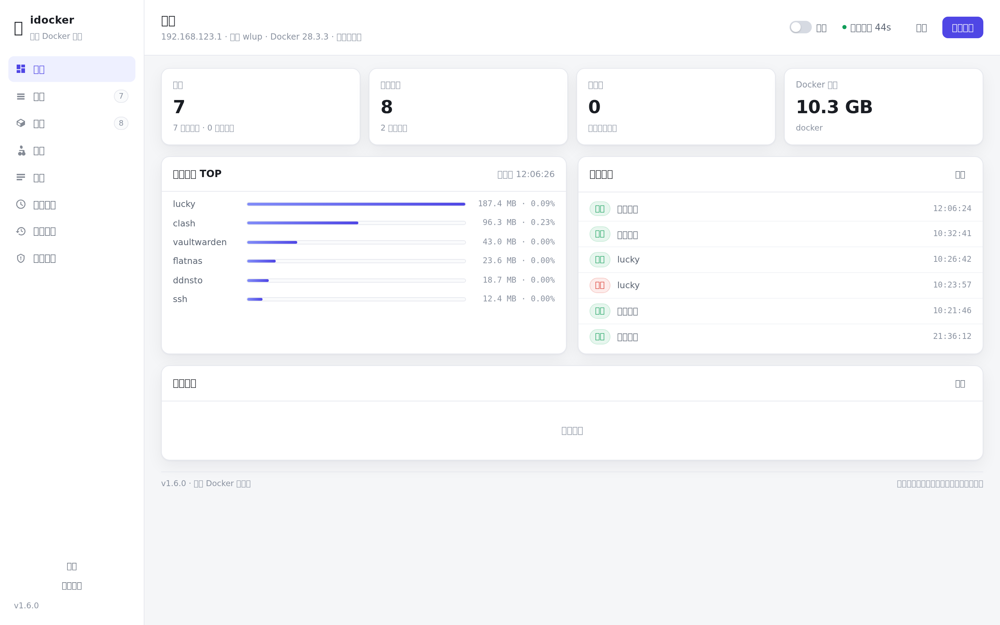
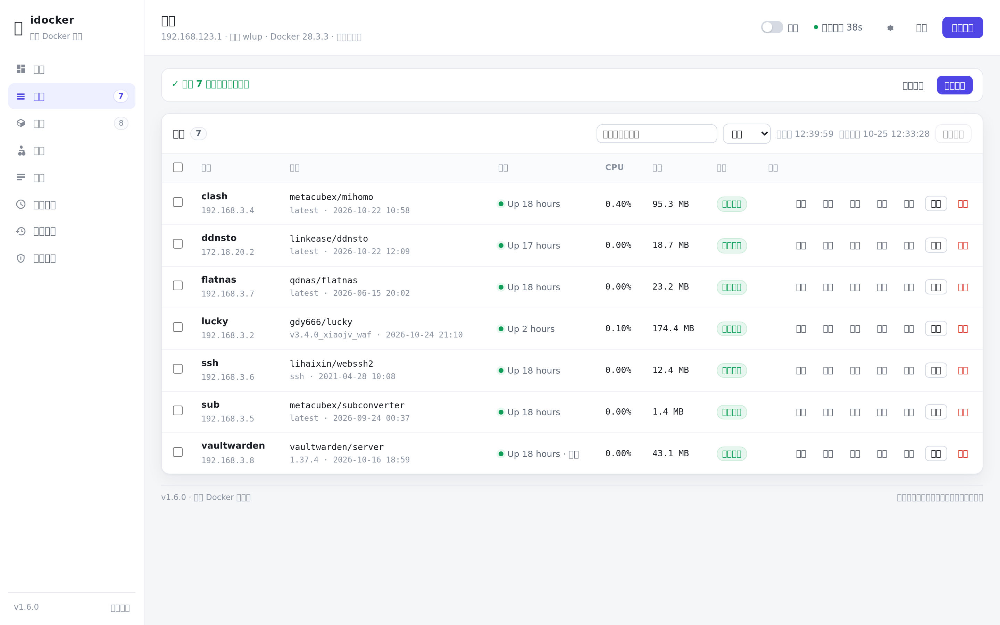
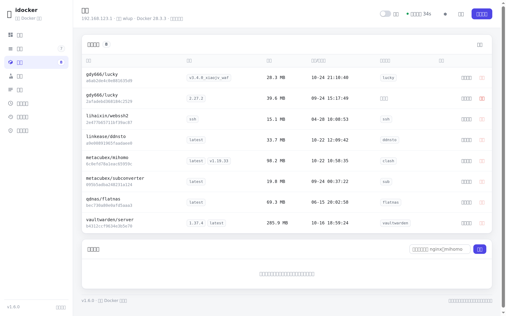
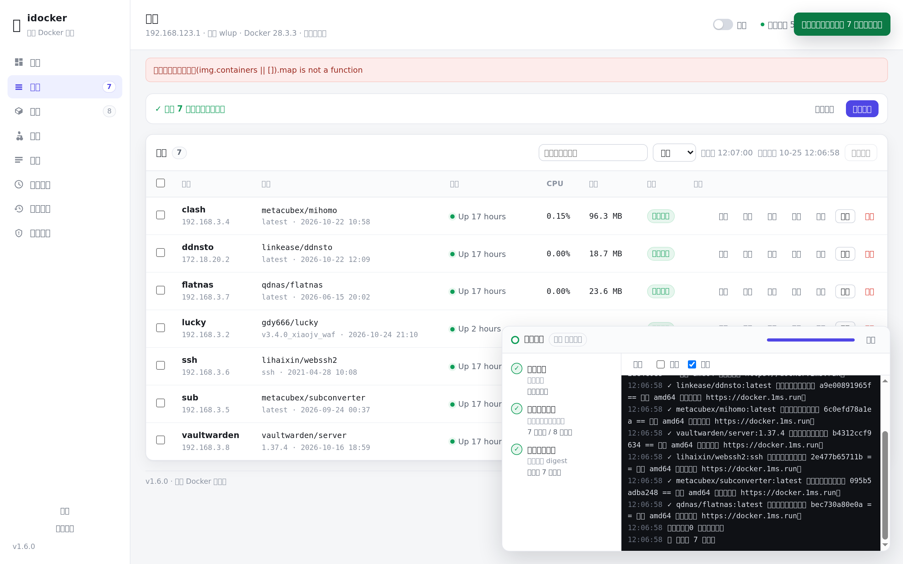

# idocker · 爱快 Docker 管理台

[](https://github.com/utterliar1/idocker/actions/workflows/ci.yml)
[](https://github.com/utterliar1/idocker/pkgs/container/idocker)

跑在飞牛 NAS（fnOS）Docker 里的一个网页，用来管**爱快（iKuai）4.0 路由器**上的 Docker：
容器、镜像、网络、Compose、服务设置、定时任务、操作审计，全在一个界面里。

它**不挂 `docker.sock`、不要 SSH、不提权**，所有操作都走爱快自己的 HTTP API，因此不会脱离爱快的编排层
（爱快用自己的库登记容器，外部工具重建后列表和配置会乱）。更新逻辑走「比对上游内容指纹 → 就地更新」，
配六步可视化流程和实时日志。

```
镜像   ghcr.io/utterliar1/idocker:latest
容器名 idocker
端口   8088（宿主机侧常用 3001）
```

---

## 界面

概览：容器 / 本地镜像 / 可更新 / Docker 磁盘四张卡，下面是资源占用 TOP、最近任务、最近操作。



容器：CPU、内存、上游版本状态都在列表里，行内直接启停、重启、看日志、看详情、选版本、更新、删除。



镜像：本地镜像的大小、拉取时间、被谁占用；下面是爱快的在线搜索，搜到就能直接拉。



执行面板：左侧流程图逐步点亮，右侧实时日志（检测三步、更新六步）。



> 截图取自实际部署在飞牛上的实例，操作的是路由器上真实的 7 个容器 / 8 个镜像。

---

## 能做什么

| 页面 | 内容 |
|---|---|
| **概览** | 容器数、镜像数、可更新数、Docker 磁盘占用；资源占用 TOP；最近任务与最近操作 |
| **容器** | 列表（镜像 / 状态 / CPU / 内存 / 上游版本）；搜索与筛选；启动、停止、重启、日志、详情、选版本、更新、删除；新建容器 |
| **镜像** | 本地镜像（大小、拉取时间、被哪些容器使用）；在线搜索并拉取；被占用的镜像拒绝删除 |
| **网络** | 子网、网关、成员容器；新建网络；还有容器在用就不能删 |
| **编排** | Compose 项目列表与日志；启动、停止、重启、清理；新建项目 |
| **定时任务** | 每 N 分钟或每天定点；只检测 / 检测到新版就更新；可指定目标容器 |
| **执行历史** | 最近 60 次执行：成功失败、每步耗时、完整日志，可一键复制 |
| **操作审计** | 所有手动管理动作留痕（含失败），`env`、密码类字段自动打码 |

界面骨架：左侧 8 个页面（地址栏带 `#containers` 这类 hash，前进后退、收藏都能用），底部只有版本号和退出登录；
顶栏是「演练」开关、自动刷新倒计时、设置齿轮、刷新、检查更新。

---

## 快速开始

镜像由 GitHub Actions 构建：每次改动先跑完整回归，全绿才打包，打包后再拉起来冒烟验证。不用自己 build。

```bash
mkdir -p /vol1/1000/docker/idocker/data && cd /vol1/1000/docker/idocker

cat > docker-compose.yml <<'YAML'
services:
  idocker:
    image: ghcr.io/utterliar1/idocker:latest
    container_name: idocker
    restart: unless-stopped
    ports:
      - "3001:8088"                 # 左边是对外端口，8088 常被 filebrowser 占
    environment:
      IKUAI_URL: "192.168.123.1"    # 爱快后台地址，只写 IP 也行
      IKUAI_USER: "admin"
      IKUAI_PASS: "你的爱快密码"
      AUTH_USER: "admin"            # 网页登录账号；留空 = 不认证（仅限内网）
      AUTH_PASS: "你的网页访问密码"
      PULL_TIMEOUT: "1800"          # 等镜像下载的最长秒数，大镜像给足
      TZ: "Asia/Shanghai"
    volumes:
      # 写宿主机绝对路径。用 ./data 时，Docker 是按「执行 compose 的那台机器」解析的，
      # 在别的机器/容器里跑 compose 会挂进一个新建的空目录 —— 历史和定时任务就没了。
      - /vol1/1000/docker/idocker/data:/data
YAML

docker compose up -d
docker compose logs -f              # 看到启动横幅即成功
```

数据目录要让容器里的 `appuser`（uid 1000）能写，属 root 就 `chown 1000:1000`。

浏览器打开 `http://飞牛IP:3001`，用 `AUTH_USER` / `AUTH_PASS` 登录。

标签：`latest`（main 每次推送）、`sha-xxxxxxx`（钉住 commit）、`1.6.0` / `1.6`（推 `v*` tag 时）。
拉不动 ghcr.io 就给镜像名加加速前缀，例如 `docker.1ms.run/ghcr.io/utterliar1/idocker:latest`。

---

## 配置

环境变量优先，`/data/settings.json` 里页面上改过的值优先于环境变量。

| 变量 | 默认 | 说明 |
|---|---|---|
| `IKUAI_URL` | — | 爱快后台地址，`192.168.123.1` 或 `https://192.168.123.1` |
| `IKUAI_USER` / `IKUAI_PASS` | — | 爱快登录账号密码（必填） |
| `AUTH_USER` / `AUTH_PASS` | — | 网页登录账号密码；`AUTH_USER` 留空 = 不认证 |
| `WEB_PORT` | `8088` | 容器内监听端口 |
| `PULL_TIMEOUT` | `900` | 等镜像下载完成的秒数；页面设置里改过的优先 |
| `HTTP_TIMEOUT` | `20` | 单次访问爱快接口的超时 |
| `DRY_RUN` | `0` | `1` = 全程只演练，不改任何容器 |
| `REGISTRIES` | 内置三个 | 仅兜底：优先用爱快 Docker 服务设置里配的加速源 |
| `NOTIFY_WEBHOOK_URL` / `NOTIFY_WEBHOOK_TOKEN` | — | 通用 webhook 通知（token 放 `X-Notify-Token` 头） |
| `NOTIFY_PUSHPLUS_TOKEN` | — | pushplus 微信推送 |
| `NOTIFY_ON` | `fail` | `off` / `fail` / `always`，页面上也能改 |
| `TZ` | — | 时区，建议 `Asia/Shanghai` |
| `BASE_IMAGE` | `python:3.13-alpine` | 仅本地构建用；拉不到 docker.io 时换加速源 |

---

## 怎么用

### 更新容器

打开页面会自己检测一次上游版本（10 分钟内的旧结果直接复用），结论写在容器页顶部的概览条上：
`⬆ 有 3 个容器可以更新` / `✓ 全部 7 个容器都已是最新` / `尚未检测`。可更新的容器自动置顶、整行高亮。

点「更新这 N 个」或行内「更新」，先弹确认框列出到底动谁、会各重启一次；确认后执行面板逐步点亮：
`登录爱快 → 读取容器配置 → 拉取新镜像 → 等待下载完成 → 就地更新容器 → 验证运行状态`。
更新走 `docker_container.update` **就地更新**，不删容器，挂载、固定 IP、环境变量都保留。

### 指定版本 / 切回 latest

行内「版本」列出该镜像的可用 tag（爱快列表为空就直连加速源读 `/tags/list`），也可以手填。
选定后会先问上游「这个 tag 到底存不存在」，不存在就立刻失败 —— 爱快对不存在的 tag 不报错，
只会下发一个永远下不完的任务，让你白等满超时。

「切到 latest」是给锁定在版本号 tag 上的容器用的：内容落后时会自动「搬运」（拉一个内容相同的版本号 tag →
把容器切过去 → 删旧的 `latest` 记录 → 重拉 `latest` → 切回来），绕开爱快「同名同 tag 就拒绝重新拉取」的死结。

### 演练模式

顶栏「演练」勾上后，完整走一遍流程并打印将要发出的请求，**不真的动任何容器**，步骤说明会标「演练：跳过等待」。
建议第一次先开着演练跑一遍。演练任务不发通知。

### 定时任务

两种模式：

| 模式 | 行为 |
|---|---|
| 仅检测版本 | 只刷新「上游」状态，完全不动容器（不选容器 = 检测全部） |
| 检测到新版就更新 | 先比对上游内容指纹，只有真的变了才拉取并重启 |

频率支持「每隔 N 分钟」（360 = 6 小时，1440 = 1 天）或「每天 HH:MM」。
同一时刻只允许一个更新任务，撞上就记一条「已跳过」，不排队堆积；演练开着时定时任务也只演练。

### 任务通知

定时任务多在凌晨跑，跑完可以推到外面：填 `NOTIFY_WEBHOOK_URL`（通用 webhook，POST 一段 JSON）或
`NOTIFY_PUSHPLUS_TOKEN`（微信）。两个都填就各发一份。

渠道只从环境变量读，**页面只显示「配了哪些」，完整 URL 和 token 不下发浏览器**；通知异步发送，
webhook 那头慢或挂掉不会拖住任务收尾；正文会单独点出失败的步骤。

### 快捷入口

```
http://飞牛IP:3001/#images                              直接落在某个页面
http://飞牛IP:3001/?autorun=check                       打开即开始检测
http://飞牛IP:3001/?autorun=update&container=clash&dry=1 预览更新流程（强制演练）
http://飞牛IP:3001/?autorefresh=300                     自动刷新间隔（默认 60 秒，5~3600）
http://飞牛IP:3001/?autocheck=0                         关掉「打开页面自动检测」（默认 600 秒）
```

### 登录

开了 `AUTH_USER` / `AUTH_PASS` 后是标准登录页（不是浏览器原生弹框），密码管理器能识别、保存、自动填充。
登录状态保持 7 天，签名 cookie（`HttpOnly` + `SameSite=Lax`）；改密码会让所有已发出的登录态立即失效；
同一来源连错 5 次锁定 60 秒。`curl` 仍可用 `-u 账号:密码` 走 Basic。

---

## 更新是怎么判断的

判断「是不是最新」只认**内容指纹**，不看时间、也不信爱快那句「已存在相同内容」：

- 本地：爱快镜像记录的 `id`，就是 config blob 的 sha256；
- 上游：`/v2/<repo>/manifests/<tag>` → 多架构 index → **amd64 子清单** → `config.digest`；
- 两者规范化后逐位比较：相等 = 最新，不等 = 落后。

必须下钻到子清单，因为 index 那一层的 digest 和本地镜像 ID 永远不同层；多架构镜像重建 arm64 时 index 会变，
但 amd64 内容一个字没动。

几条由此而来的规则：

- **已是最新就跳过重启** —— 不会为了「更新一个本来就不需要更新的容器」中断服务；
- **锁定在版本号 tag 上不算落后** —— `1.37.3`、`v2.7` 这类是刻意锁定，`1.37.3-alpine`、`latest`、`ssh`、`slim` 是并行变体，都不算；
- **认容器自己声明的 tag**，不看镜像记录的标签集合（一条记录可能同时挂 `1.37.3,latest`，拿它匹配会把锁定版误判成已跟 latest）；
- **检测结果与源健康**：坏掉的加速源重试一次后进 600 秒冷却、排到回退链队尾，HTTP 404 不算坏源（只是这个源没这个镜像）；
- **tag 预检三态**：`yes` / `no` / `unknown`，只有所有源都明确 404 才判「tag 不存在」，源全不可达时只警告。

---

## HTTP API

页面上的能力都能用 `curl` 调。开了认证时用 `-u 账号:密码`，或先 `POST /api/login` 拿会话 cookie。

| 方法 | 路径 | 作用 |
|---|---|---|
| GET | `/api/overview` | 容器（含 repo/tag、CPU、内存、上游状态）、镜像数、磁盘、最近任务与检测结果 |
| GET | `/api/stats` | 各容器实时 CPU / 内存 / 上下行 |
| GET | `/api/containers/<name>` · `/logs?minutes=30` | 容器详情（配置 + inspect + 实时资源）/ 日志 |
| POST | `/api/containers/action` | `{name, action}`：`start` / `stop` / `restart` / `delete` |
| POST | `/api/containers/create` | 新建容器 |
| GET | `/api/images` · `/api/images/search?keyword=nginx&page=1` | 本地镜像 / 在线搜索 |
| POST | `/api/images/pull` · `/api/images/delete` | `{repo, tag}`：拉取 / 删除 |
| GET/POST | `/api/networks` | 列表 / `{action: add\|delete, ...}` |
| GET | `/api/compose` · `/api/compose/<id>/logs` | 编排项目 / 项目日志 |
| POST | `/api/compose/action` · `/api/compose/create` | `{id, action}`：`up` / `down` / `restart` / `clean` / 新建 |
| GET | `/api/server/disks` · `/api/audit?limit=100` | Docker 磁盘 / 操作审计 |
| POST | `/api/server/mirrors` · `/api/server/action` | 写加速源 / Docker 服务启停 |
| POST | `/api/check` · `/api/update` | 起检测 / 更新任务，返回 `job_id` |
| GET | `/api/jobs/<id>/stream` | 任务 SSE 事件流（`snapshot` / `step` / `log` / `done`） |
| GET/POST | `/api/settings` · `/api/schedules` | 下载超时与通知 / 定时任务 |

写接口一律「先做、再回读、最后返回真实状态」：爱快写接口是异步的，`update` / `add` 甚至返回空 body，
「回 Success」不等于生效，所以每个动作之后都要重读一遍对象才算成功；对不上就返回 `4xx/5xx` 加原因。

---

## 安全

- **务必设 `AUTH_PASS`**：这个页面持有路由器凭据，未认证等于把路由器操作权限开放给整个局域网；
- **不要映射到公网**，只在内网用；
- 容器以非 root（`appuser`）运行，不挂 `docker.sock`，不需要特权；日志里密码字段自动打码；
- 审计与通知都不下发明文凭据：`env`、密码类字段统一 `***`，webhook 的完整 URL / token 只留在容器里。

---

## 排错

| 症状 | 原因与处理 |
|---|---|
| 面板全部「读取失败」，日志里 401 + nginx 页面 | `IKUAI_URL` 带了 `http://`。爱快对 http 的 `/Action/login` 会 302 到 https，跟随跳转时 POST 被降级成 GET。1.6.0 起遇到 401/403 会自动改用 https 重试；也可以直接把地址写成 `https://...` |
| 历史、定时任务、上次检测结果全没了 | 挂载写成了相对路径 `./data`，被执行 compose 的那台机器解析成空目录。改成宿主机绝对路径再重建容器，数据会回来 |
| 镜像页报 `... is not a function` | 旧版本把爱快返回的 `containers: {}`（没有容器在用的镜像）当数组用了。升级镜像即可 |
| 版本检测全部「查询失败」 | 检测用的是**爱快 Docker 服务设置里的加速源**。先去爱快后台确认源可用；日志里「查询上游用的加速源」那行会写命中哪个源、什么原因 |
| 构建时拉不到 `python:3.13-alpine` | 飞牛默认源 `docker.fnnas.com` 返回 401，Docker 不会自动回退官方源。给 `BASE_IMAGE` 加加速前缀（`docker.1ms.run/library/python:3.13-alpine`）后 `--build` |
| 容器 Up，但服务打不开 | 多半是镜像换了 entrypoint、旧容器的 `cmd` 被带过去（典型：`start.sh` 里 `ps aux \| grep` 匹配到自己的命令行，无限空转）。清空该容器的 `cmd`。工具会在更新后核查启动日志，这种情况会告警 |
| 镜像一直下不完 | 调大 `PULL_TIMEOUT`。超时只会跳过这个容器，**绝不会拿旧镜像去重建**，不会把服务搞坏 |
| 时间显示不对 | 确认 `TZ=Asia/Shanghai`，且镜像里装了 `tzdata` |

---

## 开发与测试

零依赖：Python 标准库 + 原生 JS，没有 pip 包、没有前端构建。

```bash
python _test/test_webapp.py          # 后端 313 项：假爱快 + 真 server，端到端断言
node _test/test_frontend.js          # 前端 24 项：自动刷新时序（DOM 桩跑真 app.js）
node _test/test_frontend_ux.js       # 前端 56 项：概览条 / 确认框 / 自动检测 / 轻提示
```

前端那套约 30 秒 —— 用 `?autorefresh=5` 把间隔压到 5 秒，真实等待定时器触发，不是假装睡眠。

CI（`.github/workflows/ci.yml`）三关串行：

```
① test    后端 313 + 前端 24 + 56，挂了就不产出镜像
② build   构建并推 ghcr.io（PR 只构建；main 推 latest + sha-xxxxxxx；v* tag 推语义版本）
③ smoke   真拉起来跑：/api/health、首页与静态资源、关键控件与深色样式、
          容器自带 healthcheck、非 root 运行，再起一个开了认证的实例验证登录页与会话 cookie
```

发版本就是打 tag：

```bash
git tag v1.6.0 && git push origin v1.6.0
# → ghcr.io/utterliar1/idocker:1.6.0 / :1.6 / :latest / :sha-xxxxxxx
```

---

## 目录结构

```
webapp/
├── Dockerfile              基础镜像走 ARG BASE_IMAGE；零 pip 安装
├── docker-compose.yml      部署用
├── .env.example            配置模板
├── screenshots/            实机截图
└── app/
    ├── server.py           HTTP 服务 + 路由 + SSE（纯标准库）
    ├── ikuai_api.py        爱快 4.0 API 客户端 + 镜像索引
    ├── jobs.py             任务引擎：检测/更新流程 + 事件流 + 历史
    ├── docker_ops.py       管理操作层：容器/镜像/网络/编排/服务设置 + 回读确认
    ├── audit.py            操作审计与参数脱敏（/data/audit.json）
    ├── notify.py           任务结束通知（webhook / PushPlus）
    ├── scheduler.py        定时调度（后台线程，15 秒 tick）
    ├── store.py            设置与定时任务持久化（/data/settings.json）
    ├── healthcheck.py      健康检查（开认证后 401 也算存活）
    └── static/             index.html · style.css · app.js
```

`/data` 里是 `settings.json`（超时 + 定时任务）、`state.json`（digest 基准）、`last_check.json`（上次检测结果）、
`history.json`（执行历史）、`audit.json`（审计）。都是可再生元数据，删掉只会丢历史和定时任务配置。

同仓库还有：

| 文件 | 作用 |
|---|---|
| `ikuai_docker_updater.py` | 等价的命令行版（`list` / `check` / `update` / `tags` / `server`） |
| `API_REFERENCE.md` | 爱快 4.0 Docker 接口完整参考（实测） |
| `mine_ikuai_api.py` | 接口挖掘工具，固件升级后用来重新提取接口 |
| `fnos_ssh.py` / `deploy_webapp.py` | 免交互 SSH / 一键同步部署 |
| `AGENTS.md` | 改代码前要守的约定与坑 |

---

## 已知边界

爱快 4.0 的 Docker 接口（实测）覆盖容器、镜像、网络、Compose、服务设置五块；**没有** exec 终端、
volume 管理、prune、历史监控曲线、健康详情与事件流。所以：

- 想要进容器里敲命令，还是得用 SSH 或爱快自带的终端；
- 镜像清理只能逐个删（有占用保护，不会误删正在用的）；
- CPU / 内存是每次现查（爱快没有批量接口，7 个容器约 1.4 秒）。
